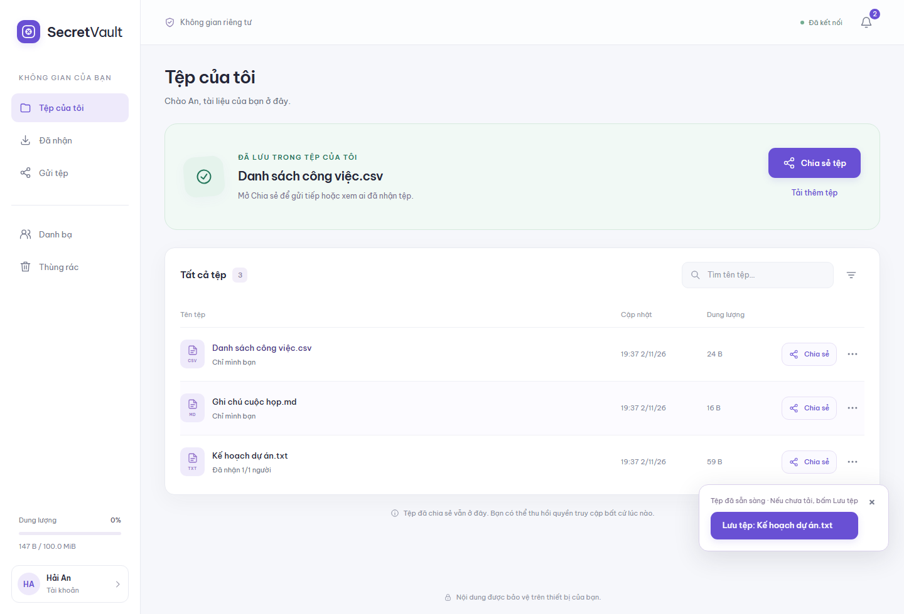
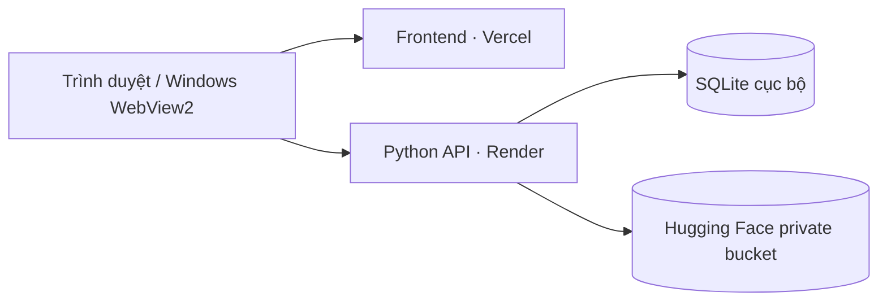

# SecretVault

**Lưu trữ và chia sẻ tệp được mã hóa ngay trên thiết bị.**

SecretVault cung cấp kho tệp cá nhân, gửi trực tiếp khi hai người cùng trực tuyến và chia sẻ để người nhận mở sau. Giao diện tiếng Việt dùng trên trình duyệt máy tính, điện thoại và ứng dụng Windows; backend viết bằng Python.

[Mở ứng dụng](https://secretvault-online.vercel.app) · [Cơ chế mật mã](docs/CRYPTOGRAPHY.md) · [Kiến trúc](docs/ARCHITECTURE.md) · [Triển khai](docs/DEPLOYMENT.md)



[Xem giao diện trên điện thoại](docs/images/workspace-mobile.png)

## Chức năng

- **Tệp của tôi:** tải lên, tìm kiếm, sắp xếp, tải xuống, thùng rác và khôi phục.
- **Gửi trực tiếp:** thiết lập khóa phiên Diffie–Hellman tạm thời, truyền tệp đã mã hóa khi hai bên cùng online.
- **Gửi để nhận sau:** dùng khóa công khai ElGamal của người nhận để bọc khóa tệp; người gửi có thể đăng xuất sau khi gửi.
- **Đã nhận:** tải về hoặc lưu một bản riêng vào kho; gửi thông báo xác nhận cho người gửi.
- **Danh bạ:** lưu người nhận và ghim danh tính khóa công khai, giúp phát hiện thay đổi khóa.
- **Phiên đăng nhập:** giữ phiên khi tải lại trang; tùy chọn ghi nhớ thiết bị tối đa bảy ngày; thu hồi khi đăng xuất.
- **Quản trị:** theo dõi tài khoản, dung lượng, tệp và hoạt động; điều chỉnh hạn mức và tạm dừng tài khoản.
- **Giao diện thích ứng:** điều hướng trên điện thoại, trạng thái tải dạng skeleton và phản hồi tiến độ khi xử lý tệp.

## Chạy trên máy

Cần **Python 3.11 trở lên** và **Node.js 22 trở lên** để chạy bộ kiểm thử. Frontend dùng JavaScript thuần, không cần cài gói npm để chạy ứng dụng.

```powershell
git clone https://github.com/ntthienphuc/secretvault.git
cd secretvault
py -3.11 -m venv .venv
.venv\Scripts\python.exe -m pip install -r requirements.txt
.venv\Scripts\python.exe -m cloudserver.main
```

Mở **http://127.0.0.1:8787**. Backend phục vụ cả web và API; dữ liệu local được tạo trong `.data/`. Không cần tài khoản dịch vụ hosting để chạy local.

Trên Linux/macOS, dùng `python3 -m venv .venv`, sau đó thay đường dẫn Python bằng `.venv/bin/python`.

Để thử gửi giữa hai tài khoản trên cùng máy, mở hai hồ sơ trình duyệt hoặc một cửa sổ thường và một cửa sổ riêng tư. Đăng ký tài khoản khác nhau trong mỗi cửa sổ.

## Mật mã được sử dụng

| Mục đích                   | Cơ chế                                                             | Mã nguồn                                                                        |
| -------------------------- | ------------------------------------------------------------------ | ------------------------------------------------------------------------------- |
| Danh tính công khai        | Cặp khóa ElGamal, cặp ký Ed25519 và fingerprint SHA-256            | [`makeAccount`, `publicFingerprint`](web/src/crypto.js)                         |
| Gửi trực tiếp              | Diffie–Hellman tạm thời, MODP3072; HKDF-SHA256 dẫn xuất khóa phiên | [`ephemeral`, `sessionKey`](web/src/crypto.js)                                  |
| Gửi để nhận sau            | ElGamal Hybrid: bí mật nhóm → HKDF → AES-GCM bọc khóa tệp          | [`wrapElgamal`, `unwrapElgamal`](web/src/crypto.js)                             |
| Nội dung tệp               | AES-256-GCM theo chunk, IV và AAD riêng cho từng chunk             | [`encrypt`, `decrypt`, `chunkIv`](web/src/crypto.js)                            |
| Tính toàn vẹn và nguồn gửi | Ed25519 ký manifest, lời mời, chấp nhận và envelope                | [`sign`, `verify`](web/src/crypto.js), [`security.py`](vaultserver/security.py) |
| Bảo vệ khóa riêng          | PBKDF2-SHA256, 600.000 vòng, salt ngẫu nhiên và AES-GCM            | [`makeAccount`, `unlockAccount`](web/src/crypto.js)                             |

Diffie–Hellman là bước **thỏa thuận khóa**; ElGamal Hybrid là bước **bảo vệ khóa tệp cho người nhận**. Nội dung tệp trong cả hai luồng được mã hóa bằng AES-GCM. Công thức, cấu trúc thông điệp, vòng đời khóa và giả định bảo mật được mô tả trong [tài liệu mật mã](docs/CRYPTOGRAPHY.md).

## Kiến trúc



Frontend mã hóa và giải mã trên thiết bị. API xác thực phiên, kiểm tra chữ ký, phân quyền, áp dụng hạn mức và lưu bản mã. Bucket lưu các chunk mã hóa cùng snapshot metadata; frontend không chứa token truy cập bucket.

## Cấu trúc dự án

```text
web/                Giao diện, mật mã phía client, quản lý phiên
cloudserver/        API FastAPI, chính sách tài khoản, chia sẻ, lưu trữ
vaultserver/        HTTP handler, xác thực, chữ ký, SQLite
cloud_client_app.py Ứng dụng Windows với Edge WebView2
packaging/          Script tạo bộ cài Windows
scripts/            Chạy kiểm thử và tạo mã kích hoạt quản trị
tests/              Kiểm thử mật mã, API, lưu trữ và giao diện
docs/               Kiến trúc, mật mã, triển khai và hướng dẫn kiểm thử
```

## Kiểm thử

```powershell
node hosting/build-web.mjs
.venv\Scripts\python.exe scripts/test.py
```

Trình chạy tự khởi động server local, dùng thư mục dữ liệu tạm và tắt server sau mỗi nhóm kiểm thử. Xem [TESTING.md](docs/TESTING.md) để biết phạm vi kiểm tra.

## Ứng dụng Windows và quản trị

- [Tạo bộ cài Windows](docs/DEPLOYMENT.md#ứng-dụng-windows).
- [Khởi tạo tài khoản quản trị](docs/DEPLOYMENT.md#khởi-tạo-quản-trị).
- [Hướng dẫn gửi và nhận tệp](docs/USER_GUIDE.md).

Giới hạn mặc định: **25 MiB/tệp**, **100 MiB/tài khoản**, **512 MiB/toàn hệ thống**, **50 tài khoản**. Tệp trong thùng rác vẫn tính dung lượng. Chưa có chức năng khôi phục mật khẩu; cần giữ mật khẩu để mở khóa dữ liệu trên thiết bị mới.

Font Be Vietnam Pro được phân phối theo [SIL Open Font License](web/assets/fonts/OFL.txt).
