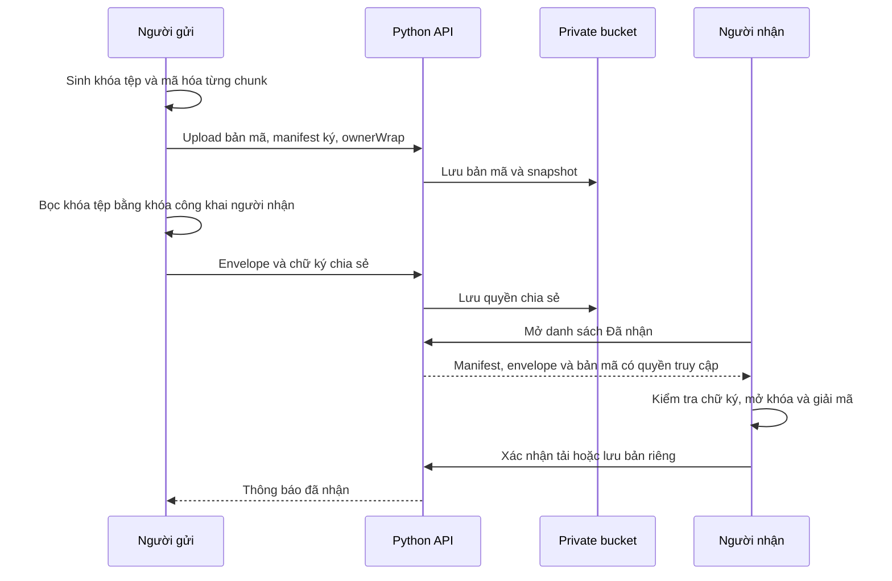

# Kiến trúc SecretVault

## Các thành phần

| Thành phần                      | Trách nhiệm                                                             |
| ------------------------------- | ----------------------------------------------------------------------- |
| `web/src/app.js`                | Điều phối tài khoản, kho tệp, gửi trực tiếp, chia sẻ và thông báo       |
| `web/src/crypto.js`             | Danh tính, nhóm hữu hạn, DH, ElGamal Hybrid, AES-GCM, HKDF và chữ ký    |
| `web/src/remember.js`           | Cache mở khóa trên thiết bị bằng IndexedDB và CryptoKey không xuất được |
| `web/src/view.js`, `loading.js` | Hiển thị màn hình, trạng thái rỗng, đang tải, lỗi và thử lại            |
| `cloudserver/main.py`           | FastAPI ingress, CORS, giới hạn request và phục vụ web local            |
| `cloudserver/handler.py`        | Phiên, quota, quản trị, chính sách tài khoản và API mở rộng             |
| `cloudserver/delivery.py`       | Xác nhận đã nhận, lưu bản riêng và thông báo                            |
| `cloudserver/store.py`          | Giao dịch SQLite, snapshot, khôi phục và thu hồi dữ liệu                |
| `cloudserver/bucket.py`         | Đọc/ghi bucket riêng tư và giữ các snapshot gần nhất                    |
| `vaultserver/`                  | HTTP handler nền, xác thực, kiểm tra chữ ký, ACL và schema              |
| `cloud_client_app.py`           | Cửa sổ Windows sử dụng cùng web/API và hồ sơ WebView2                   |

## Luồng lưu và chia sẻ

Xác nhận tải được gửi khi ứng dụng đã chuẩn bị nội dung giải mã để tải về. Trình duyệt không thể xác nhận người dùng đã đọc tài liệu hay tệp đã được ghi xong xuống ổ đĩa. Lưu bản riêng tạo tệp mới thuộc người nhận, dùng khóa mới và được tính vào quota của người nhận.

## Dữ liệu và giao dịch

SQLite chạy trên ổ đĩa local của backend. Giao dịch thay đổi dữ liệu bền vững được kết hợp thành snapshot bất biến và kiểm tra checksum trước khi API báo thành công. Với bucket, backend giữ ba snapshot mới nhất và dọn các snapshot cũ ngoài đường xử lý chính.

Khi khởi động lại, server đọc snapshot hợp lệ gần nhất. Nếu snapshot mới nhất bị hỏng, server thử bản trước; nếu toàn bộ trạng thái hỏng, server báo lỗi thay vì tạo một kho trống. Đối với deploy online, chỉ chạy **một tiến trình ghi dữ liệu**; không tăng replica hoặc worker khi chưa bổ sung cơ chế đồng bộ ghi.

| Dữ liệu                                                              | Vị trí                                                              |
| -------------------------------------------------------------------- | ------------------------------------------------------------------- |
| Nội dung tệp đã mã hóa                                               | `secretvault/ciphertext/` trong bucket                              |
| Tài khoản, public key, bundle mã hóa, danh bạ, ACL, quota, thông báo | Snapshot tại `secretvault/metadata/`                                |
| SQLite và cache runtime                                              | Local filesystem của server                                         |
| Khóa đang mở, khóa DH tạm thời                                       | Bộ nhớ client                                                       |
| Phiên thông thường, payload truyền trực tiếp                         | Trạng thái tạm thời; không khôi phục sau restart server             |
| Phiên được chọn ghi nhớ                                              | Token hash phía server và cache mã hóa phía client, tối đa bảy ngày |

## Phân quyền và trạng thái

Mọi thao tác tải chunk, chia sẻ, thu hồi, xóa tệp và quản trị đều kiểm tra quyền tại API. Việc ẩn nút trên giao diện không thay thế kiểm tra phía server.

Tệp mới đi qua trạng thái cấp phát → tải chunk → xác nhận manifest → sẵn sàng. Upload chưa xác nhận có thể hủy. Tệp sẵn sàng phải vào thùng rác trước khi xóa vĩnh viễn. Thu hồi chia sẻ chặn các lượt tải tiếp theo; bản đã tải hoặc đã lưu riêng vẫn do người nhận giữ.

Quản trị viên xem được danh tính tài khoản, tên tệp, dung lượng, thời điểm và sự kiện hoạt động. Dashboard không trả về khóa riêng, bundle mã hóa, token đăng nhập hoặc nội dung tệp giải mã.

## Web và Windows

Local chạy chung một origin tại `http://127.0.0.1:8787`. Online tách frontend Vercel và API Render; CORS chỉ chấp nhận origin được cấu hình. Hugging Face được dùng làm Storage Bucket riêng tư.

Ứng dụng Windows tải giao diện online bằng Edge WebView2, dùng cùng tài khoản và dữ liệu với trình duyệt. Người dùng không cần chạy một backend trên máy Windows. Bản thân ứng dụng Windows cần Internet để sử dụng dịch vụ online.
